<div align="center">

# 🌊 RESQNET
### AI-Powered Disaster Response Coordination System
**Turn emergency reports into coordinated, explainable and accountable rescue operations.**

---

> **Faster response. &nbsp;|&nbsp; Better coordination. &nbsp;|&nbsp; Safer communities.**

<br/>

[](https://python.org)
[](https://fastapi.tiangolo.com)
[](https://nextjs.org)
[](https://www.typescriptlang.org)
[](https://tailwindcss.com)
[](https://www.postgresql.org)
[](#-system-architecture)
[](#)

</div>

---

## 🎯 About

**RESQNET** is a multi-agent disaster response coordination system designed to improve emergency response during disasters such as urban floods.

It uses two **AI agents**: a **Triage Agent** to analyse and prioritise incoming emergency reports, and a **Response Coordination Agent** to recommend suitable rescue teams based on availability, capacity, location and resource requirements.

A central orchestrator coordinates both agents, while **human approval is mandatory** before every simulated dispatch. The platform provides an operational dashboard, incident mapping, resource coordination, multilingual notifications and an append-only audit trail.

---

## ⚙️ System Architecture

```mermaid
flowchart LR
    subgraph Inputs ["Inputs"]
        direction TB
        I1["📄 Emergency Reports<br/>(Web, Mobile, Call)"]
        I2["👤 Citizen / Field Reports"]
        I3["☁️ External Data<br/>(Weather, Maps, etc.)"]
    end

    subgraph RESQNET ["RESQNET (Multi-Agent System)"]
        direction LR
        A1["🔍 <b>Triage Agent</b><br/>Analyse & prioritise<br/>emergency reports"]
        O["⚙️ <b>Orchestrator</b><br/>Coordinates agents<br/>& manages workflow"]
        A2["👥 <b>Response<br/>Coordination Agent</b><br/>Finds suitable teams<br/>based on availability,<br/>location & resources"]
        H["🛡️ <b>Human Approval</b><br/>Review & approve<br/>dispatch plan"]
        
        A1 --> O
        O --> A2
        A2 --> H
    end

    subgraph Outputs ["Outputs"]
        direction TB
        O1["🚑 Rescue Team Dispatch<br/>(Simulated)"]
        O2["📍 Live Incident Map"]
        O3["🔔 Multilingual Alerts"]
        O4["📊 Resource Tracking"]
        O5["📑 Audit Trail & Reports"]
    end

    Inputs --> A1
    H --> Outputs

    style RESQNET fill:#F8FAFC,stroke:#2563EB,stroke-width:2px,stroke-dasharray: 5 5
    style A1 fill:#EFF6FF,stroke:#3B82F6,stroke-width:1.5px
    style O fill:#FAF5FF,stroke:#8B5CF6,stroke-width:1.5px
    style A2 fill:#F0FDF4,stroke:#22C55E,stroke-width:1.5px
    style H fill:#FEF3C7,stroke:#F59E0B,stroke-width:1.5px
```



---

## ⭐ Key Features

| Feature | Description |
| :--- | :--- |
| 📄 **AI-Powered Triage** | Autonomous parsing and prioritisation of emergency distress reports using structured decision explanations. |
| 🛡️ **Human-in-the-Loop** | Every physical dispatch requires explicit human operator authorisation through a 7-point pre-flight safety check. |
| 🔔 **Multilingual Notifications** | Generates instant area-wise emergency status updates in both Hindi (हिन्दी) and English. |
| 👥 **Smart Team Recommendation** | Proximity-based matching of available rescue units based on crew capacity, capabilities, and required gear. |
| 🗺️ **Live Dashboard & Maps** | Interactive Leaflet flood map displaying real-time incident pins, team locations, and operational KPI telemetry. |
| 📑 **Append-Only Audit Trail** | Immutable record of all system events, agent decisions, and commander approvals for transparent post-disaster accountability. |

---

## 🛠️ Tech Stack & Project Layout

<table>
<tr>
<th width="35%">🔧 Tech Stack</th>
<th width="65%">📁 Project Structure</th>
</tr>
<tr>
<td valign="top">

- **Frontend:** Next.js 16 (App Router), React 19, TypeScript, Tailwind CSS, Lucide React
- **Backend:** Python 3.11+, FastAPI, SQLAlchemy 2.0, Pydantic v2
- **Database:** PostgreSQL 15+ (Canonical)
- **AI / Agents:** LiteLLM / Google Gemini / OpenAI Structured Outputs
- **Maps & Tools:** Leaflet / OpenStreetMap
- **Version Control:** Git & GitHub

</td>
<td valign="top">

```text
RESQNET/
├── backend/            # FastAPI Application Server
│   ├── app/            # API endpoints, agents, models & services
│   ├── tests/          # Pytest test suite
│   ├── requirements.txt# Python dependencies
│   └── .env.example    # Backend environment template
├── frontend/           # Next.js Application Client
│   ├── src/            # App Router pages, components & design system
│   ├── public/         # Static assets
│   ├── package.json    # Frontend dependencies
│   └── .env.example    # Frontend environment template
├── docs/               # Engineering Specs (PRD, TRD, APP_FLOW, etc.)
├── .gitignore          # Excludes venv, node_modules, and .env files
└── README.md           # Project documentation
```

</td>
</tr>
</table>

---

## 🚀 Getting Started

### 1. Clone the repository
```bash
git clone https://github.com/aditrajsharma/RESQNET.git
cd RESQNET
```

### 2. Backend Setup (FastAPI)
```bash
cd backend
python -m venv venv

# Windows (PowerShell)
.\venv\Scripts\Activate.ps1

# Linux / macOS
source venv/bin/activate

# Install dependencies
pip install -r requirements.txt

# Run the backend server
uvicorn app.main:app --host 127.0.0.1 --port 8000 --reload
```

### 3. Frontend Setup (Next.js)
```bash
cd frontend
npm install
npm run dev
```

---

### 🌐 Access Points & Verification

- **Frontend Dashboard:** [http://localhost:3000](http://localhost:3000)
- **Backend API:** [http://127.0.0.1:8000](http://127.0.0.1:8000)
- **Interactive API Docs (Swagger):** [http://127.0.0.1:8000/docs](http://127.0.0.1:8000/docs)
- **Health Check Endpoint:** [http://127.0.0.1:8000/health](http://127.0.0.1:8000/health)

---

## 🏆 Our Goal

> **Help rescue teams respond faster and stay better coordinated during disasters by turning fragmented emergency information into coordinated, explainable and accountable rescue operations.**
