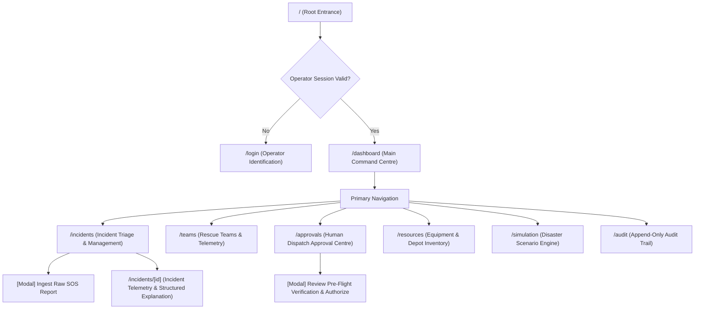
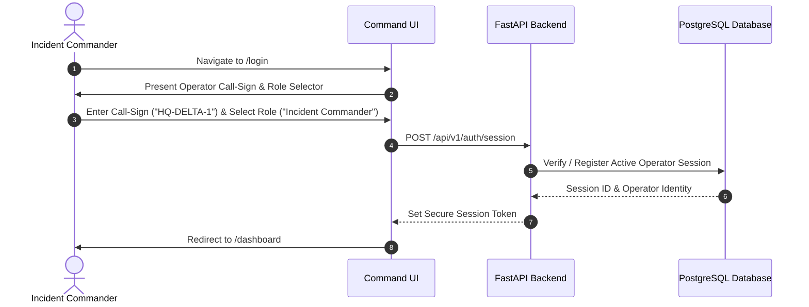
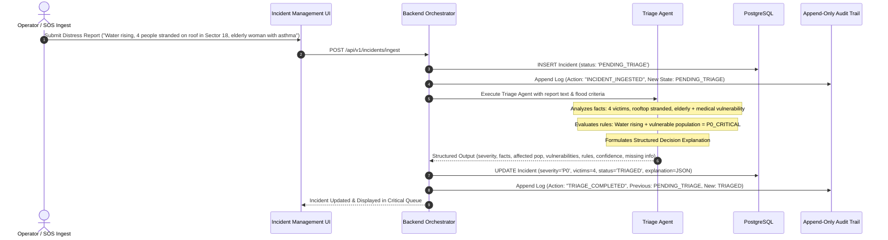
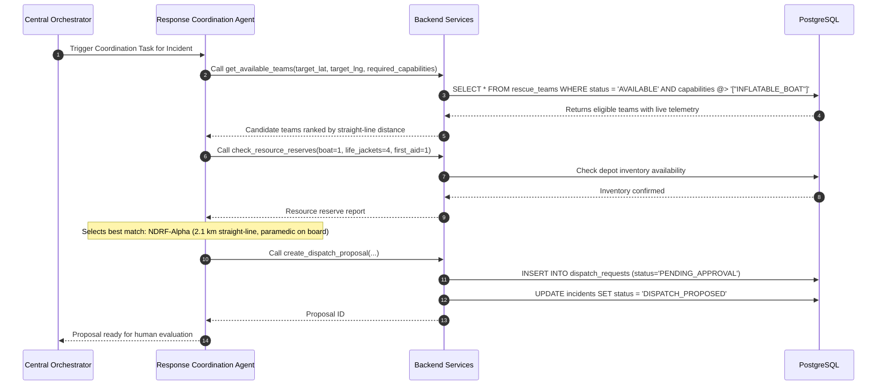
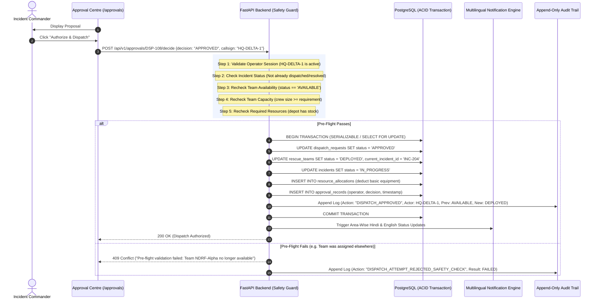
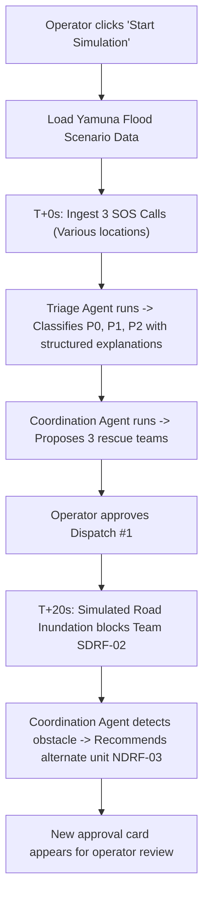

# RESQNET — Application Flow Document (APP_FLOW.md)

**Document Version:** 1.1.0 (Audited & Revised)  
**Target Release:** AgentX Hackathon 2026 (PS-03: Multi-Agent Disaster Response Coordinator)  
**Architecture:** Solo Developer — FastAPI Monolith + Next.js Frontend  
**Database:** PostgreSQL (Canonical MVP Engine)  
**Execution Context:** Simulated Emergency Response Command Operations  

---

## 1. Overview & System Persona Distinction

RESQNET is an operational emergency dispatch command dashboard focused on flood-response coordination. Dispatch operations in this system are strictly **simulated** for testing and hackathon evaluation; the application is never connected to actual emergency dispatch infrastructure.

To ensure deterministic operational safety during simulated disaster scenarios, the system enforces a strict boundary between operator actions and autonomous agent actions:

1. **Operator Actions (Human-in-the-Loop):**
   - Ingests raw emergency distress reports (radio dispatch, citizen portal, simulated feeds).
   - Reviews structured triage analysis and assigned severity.
   - Reviews AI-recommended rescue team and resource allocations.
   - Executes human authorization for dispatch via a strict pre-flight safety check.
   - Initiates area-wise multilingual emergency broadcasts.
   - Triggers and monitors disaster scenario simulations.

2. **Autonomous Agent Actions (Central Orchestrator):**
   - **Triage Agent:** Ingests unformatted reports, parses distress facts, assesses affected population, flags vulnerability indicators, applies prioritisation rules, calculates confidence scores, identifies missing/uncertain data, classifies severity (`P0_CRITICAL`, `P1_HIGH`, `P2_MEDIUM`, `P3_LOW`), and outputs a **structured decision explanation**.
   - **Response Coordination Agent:** Receives prioritized incidents, queries active rescue teams, verifies real-time availability and capacity, checks required resource reserves, calculates straight-line geographic distance and ETA estimates, and formulates a provisional deployment proposal (`PENDING_APPROVAL`).

3. **Deterministic Backend Support Services:**
   - **Pre-Flight Dispatch Safety Verification Engine:** Runs a 7-point validation check before any dispatch approval is committed to the database.
   - **Area-Wise Multilingual Notification Service (P0):** Formulates deterministic Hindi and English status updates.
   - **Geo-Distance Service:** Computes straight-line Haversine distance as an MVP baseline (distinguished from real road-route distance).
   - **Append-Only Audit Trail:** Records immutable operational logs of all state changes with previous and new states.

---

## 2. Global Navigation Hierarchy

The application adopts a flat, fast-navigation single-operator layout built on Next.js.

---

## 3. Detailed Workflow Specifications

### 3.1 Application Entry & Operator Authentication Flow
For the solo-developer MVP scope, authentication establishes an operator session with an operational call-sign (`HQ-DELTA-1`) and validated role permissions.

---

### 3.2 Main Command Dashboard Workflow
The Command Dashboard consolidates real-time situational awareness into synchronized viewports:
1. **Operational Summary KPI Bar:** Active incidents count, critical P0 emergencies, available vs deployed rescue units, pending human approvals.
2. **Interactive Disaster Map (Leaflet):** Geo-pins color-coded by incident severity and team status. Displays straight-line coverage vectors.
3. **Critical Triage Queue:** Incidents classified as P0 or P1 awaiting commander attention.
4. **Live Activity Stream:** Displays recent agent assessments, proposals, and operator decisions.

---

### 3.3 Incident Ingestion & AI Triage Workflow

#### Structured Decision Explanation Schema
The Triage Agent never outputs unconstrained conversational text. It emits a verified JSON structure:
- **Assigned Severity:** `P0_CRITICAL`, `P1_HIGH`, `P2_MEDIUM`, or `P3_LOW`.
- **Extracted Incident Facts:** Specific observable realities (e.g. `water_level_ft: 6.0`, `structure: "rooftop"`).
- **Affected Population:** Total trapped/injured count (`count: 4`).
- **Vulnerability Indicators:** High-risk tags (`["ELDERLY", "RESPIRATORY_ASTHMA"]`).
- **Relevant Prioritisation Rules:** Explicit emergency doctrine applied (e.g. `RULE-FL-01: Rising floodwater with medical vulnerability triggers immediate P0`).
- **Confidence Score:** Numerical rating `0.0 to 1.0` reflecting factual completeness.
- **Missing or Uncertain Information:** Explicitly flagged unknowns (e.g. `["exact rooftop structural stability", "battery level of reporter"]`).

---

### 3.4 Response Coordination & Proposal Generation
Triggered automatically when an incident reaches `TRIAGED` with severity `P0` or `P1`:

---

### 3.5 Dispatch Safety & Human-in-the-Loop Approval Workflow
**Absolute Requirement:** Before an approval is executed, the backend enforces a mandatory **7-Point Pre-Flight Verification**. An LLM cannot approve a dispatch or modify physical team deployment status.

---

### 3.6 Area-Wise Multilingual Status Updates (P0)
Following approval, the system generates area-wise status updates in **Hindi** and **English**:

1. **Trigger:** Dispatch status confirmed as `APPROVED`.
2. **Deterministic Formatting Engine:** Combines incident location, assigned unit call-sign, and estimated arrival time into pre-verified civil defence templates.
3. **Template Specifications:**
   - **English:** `"RESQNET Advisory [Sector 18]: Rescue Unit [NDRF Alpha Boat Unit] has been deployed to your area. Estimated arrival: 10 minutes. Stay on upper floors and keep clear of electrical fixtures."`
   - **Hindi (हिन्दी):** `"रेस्क्यूनेट आपदा सूचना [Sector 18]: बचाव दल [NDRF Alpha Boat Unit] आपके क्षेत्र के लिए रवाना कर दिया गया है। अनुमानित समय: 10 मिनट। कृपया ऊपरी मंजिल पर रहें और बिजली के उपकरणों से दूर रहें।"`
4. **Persistence:** Written to the `notifications` table with status `RECORDED_AND_BROADCAST`.

---

### 3.7 Disaster Simulation Engine Workflow
Allows one-click playback of simulated flood scenarios (e.g. *Yamuna Basin Flash Flood*) to demonstrate end-to-end agent cooperation and dynamic team reassignment during hackathon evaluations.

---

### 3.8 Append-Only Audit Trail Workflow
- Every state change writes a new immutable row to `action_logs`.
- Records include: `action_type`, `actor`, `timestamp`, `incident_id`, `previous_state`, `new_state`, and `action_result`.
- **Zero Modification Endpoints:** The backend provides **no** `PUT`, `PATCH`, or `DELETE` endpoints for audit records.

---

### 3.9 Error & Safety Fallback Flows

| Failure Event | System Detection | Deterministic Fallback Handling |
| :--- | :--- | :--- |
| **LLM Provider API Outage (>8s)** | HTTP Timeout / Exception | Bypasses LLM. Executes **Deterministic Rule-Based Triage** using keyword hazard heuristics ("roof", "trapped", "medical", "infant"). Assigns severity, flags `TRIAGED_BY_FALLBACK_RULES`, and creates structured explanation. |
| **Malformed Output** | Pydantic `ValidationError` | Retries once with schema error context. If 2nd attempt fails, assigns `P1_UNVERIFIED` and requests operator verification. |
| **No Teams Available** | Spatial query returns 0 units | Incident marked `QUEUED_NO_TEAMS`. Operator alerted to request inter-agency mutual aid. |
| **Concurrent Dispatch Conflict** | Row lock / Conflict check | Second request receives `409 Conflict: Proposal already decided`. Prevents duplicate dispatches. |
