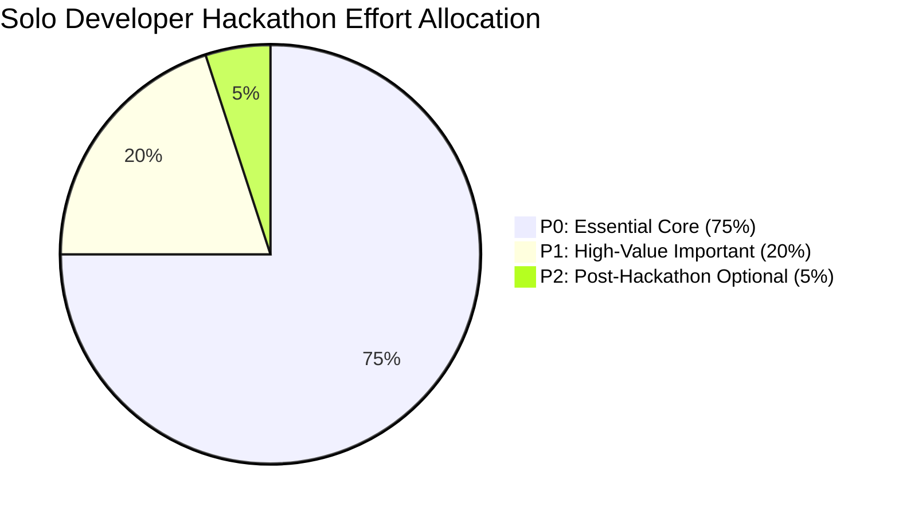

# RESQNET — Product Requirements Document (PRD)

**Document Version:** 1.1.0 (Audited & Revised)  
**Target Release:** AgentX Hackathon 2026 (Hack4Hack — PS-03: Multi-Agent Disaster Response Coordinator)  
**Engineering Model:** Solo Developer Workflow (Project Owner + Google Antigravity)  
**Primary Focus:** Flood Disaster Response & Command Coordination (Controlled Simulation)  

---

## 1. Product Overview

**RESQNET** (ResQNet – Multi-Agent Disaster Response and Coordination System) is an intelligent, human-in-the-loop operational command centre engineered to streamline disaster response during major flood emergencies. 

All emergency dispatches within RESQNET are **strictly simulated** for testing, evaluation, and demonstration purposes. The system is intentionally isolated from actual emergency dispatch infrastructure.

Rather than functioning as a conversational chatbot, RESQNET coordinates **two specialized AI agents**—the **Triage Agent** and the **Response Coordination Agent**—operating alongside deterministic backend engines to ingest chaotic distress calls, prioritize human lives, formulate tactical rescue team deployment recommendations, verify basic equipment reserves, and generate area-wise status updates in both Hindi and English.

Crucially, RESQNET enforces a strict **Human-in-the-Loop (HITL)** architecture: autonomous agents prepare intelligence, verify resource feasibility, and propose dispatch plans, but no physical rescue unit or depot inventory can be committed without explicit operator approval following a deterministic **7-Point Pre-Flight Verification**.

---

## 2. Problem Statement

During catastrophic floods (such as urban inundation or river basin overflows):
1. **Distress Call Inundation:** Emergency hotlines and digital feeds are overwhelmed with unstructured, fragmented messages. Critical life-threatening emergencies (e.g. stranded infants, medical emergencies, roof inundation) get buried under non-critical inquiries.
2. **Resource Allocation Blindspots:** Emergency Operations Centre (EOC) coordinators lack a unified real-time operational picture of which rescue boats, divers, and medical kits are physically deployed versus available nearby.
3. **Coordination Delays & Friction:** Cross-referencing team locations, watercraft requirements, victim medical needs, and equipment takes human operators 15–30 minutes per incident—costing lives in fast-rising waters.
4. **Communication Vacuum:** Citizens trapped in flooded zones receive zero confirmation of whether their distress call was received or when help is en route, leading to repeated calls and extreme panic.

---

## 3. Product Vision & Core Objectives

### Vision
To provide emergency commanders with an intelligent, self-synchronizing co-pilot that eliminates operational fog, automates cognitive triage, and computes optimal rescue allocations in seconds while keeping human operators in sovereign control.

### Hackathon Objectives (24-Hour Scope)
1. Deliver a **fully functioning, demonstrable prototype** for flood emergency scenarios.
2. Demonstrate **actual cooperation between both AI agents** through structured tool calling and shared state.
3. Guarantee **zero unapproved or conflicting dispatches** through a rigorous 7-point pre-flight validation check.
4. Provide a **responsive, light-theme operational dashboard** with an interactive disaster map.
5. Provide **area-wise status updates in Hindi and English** immediately upon dispatch authorization.
6. Maintain an **append-only audit trail** recording all state changes across the system.
7. Include a built-in **Disaster Simulation Engine** to dynamically showcase end-to-end incident lifecycles live during evaluation.

---

## 4. Target Users & Personas

### Persona 1: Vikram Singh — Incident Commander (Primary User)
- **Role:** Chief of Emergency Operations Centre (EOC).
- **Goal:** Maintain situational awareness of the flood sector, prioritize life-threatening incidents, and authorize rescue team deployments with high confidence.
- **Pain Point:** Overwhelmed by simultaneous radio chatter and multiple disparate spreadsheets; terrified of sending the wrong boat to the wrong location.

### Persona 2: Sunita Sharma — Field Rescue Team Leader (Secondary User)
- **Role:** Commander of an NDRF (National Disaster Response Force) 6-person boat crew.
- **Goal:** Receive clear, structured mission parameters: GPS coordinates, water depth, victim count, and specific medical hazards.
- **Pain Point:** Dispatched to locations without adequate equipment (e.g. arriving with a van when an inflatable boat is needed).

### Persona 3: Ramesh Patel — Affected Citizen (Beneficiary)
- **Role:** Resident trapped on a residential first floor in a rising flood.
- **Goal:** Request immediate rescue and know that help is en route.
- **Language:** Prefers Hindi (हिन्दी) or English.
- **Pain Point:** Phone battery dying, water rising, zero status updates after sending an SOS.

---

## 5. Correct & Audited Scope Prioritisation

The MVP prioritisation is rigorously aligned with PS-03 problem statement requirements and realistic solo-developer feasibility:

### P0 — Essential Core (Must Work Flawlessly in Hackathon Demo)
- **Incident Ingestion & Management:** Ingestion, validation, searching, filtering, and lifecycle tracking of flood distress calls.
- **Triage Agent:** Autonomous analysis of raw distress calls, extracting facts, identifying vulnerabilities, and outputting a **structured decision explanation**.
- **Response Coordination Agent:** Evaluating prioritized incidents against live team readiness and recommending the optimal team and gear package.
- **Actual Agent Cooperation:** End-to-end orchestrated workflow where the output of Triage triggers and parameterizes Response Coordination.
- **Team Availability & Capacity Checking:** Deterministic querying of active team status, crew capacity, and operational readiness.
- **Rescue-Team Assignment Recommendations:** Matching team capabilities (e.g. `INFLATABLE_BOAT`, `PARAMEDIC`) to incident parameters.
- **Basic Resource Allocation:** Verifying required equipment (boats, life jackets, medical kits) against depot availability.
- **Human Approval Before Dispatch:** Mandatory 7-point pre-flight safety check before any dispatch status change or allocation commit.
- **Area-Wise Hindi & English Status Updates:** Automated generation and broadcast of verified bilingual advisory messages for citizens and teams.
- **Live Operational Dashboard:** Single-pane command hub with KPI counters, critical queue, and activity stream.
- **Interactive Disaster Map:** Leaflet map rendering color-coded incident pins, team locations, and coverage vectors.
- **Append-Only Action History:** Complete audit trail tracking actor, action type, timestamp, incident ID, previous state, new state, and result.

### P1 — Important Features (Implemented for Enhanced Demonstration)
- **Advanced Inventory Deduction:** Multi-depot supply rebalancing and reservation hold expiries.
- **Dynamic Rescue-Team Reassignment Simulation:** Automated detection of road blockages during simulation with dynamic recommendation of alternate units.
- **Advanced Resource Analytics:** Depot burn-rate projections and flood-stage equipment depletion graphs.
- **Additional Regional Languages:** Support for Bengali, Marathi, or Tamil emergency templates.
- **Advanced Route Optimisation:** Calculation of flood-inundated road-network paths using elevation models (distinguished from straight-line Haversine distance).

### P2 — Optional / Future Enhancements (Strictly Deferred)
- Real WhatsApp Business API / Twilio SMS Gateway integration (mocked via database ledger for demo).
- Multi-tenant role permissions and OAuth2 SSO.
- Voice SOS ingestion via Whisper speech-to-text.

---

## 6. Detailed Feature Requirements & Acceptance Criteria

### Feature 1: AI-Powered Incident Ingestion & Triage (P0)
- **User Story:** *As an Incident Commander, I want incoming distress reports to be parsed into structured operational facts so that life-threatening cases are prioritized without manual data entry.*
- **Expected Behaviour:**
  1. Operator inputs unformatted text or simulated SOS arrives: e.g. `"Water 6ft high in Yamuna Bazar, 5 people on roof, 2 elderly individuals with mobility issues"`.
  2. Orchestrator triggers the Triage Agent.
  3. The agent emits a **structured decision explanation**:
     - **Assigned Severity:** `P0_CRITICAL`.
     - **Extracted Facts:** Water depth 6ft, rooftop refuge, Yamuna Bazar.
     - **Affected Population:** 5 individuals.
     - **Vulnerability Indicators:** `["ELDERLY", "MOBILITY_IMPAIRED"]`.
     - **Relevant Prioritisation Rules:** `RULE-FL-01: Deep floodwaters with mobility-impaired victims requires immediate P0 intervention`.
     - **Confidence Score:** `0.95`.
     - **Missing / Uncertain Information:** `["Rooftop structural integrity unknown", "Contact phone battery status unknown"]`.
  4. The incident is saved and immediately visible on the command dashboard.
- **Acceptance Criteria:**
  - [x] Zero conversational filler; structured JSON output adhering to schema.
  - [x] P0 incidents trigger a distinct red visual badge and top queue ranking.
  - [x] Deterministic regex fallback executes if LLM fails or times out (>8s).

### Feature 2: Response Coordination Agent & Basic Resource Allocation (P0)
- **User Story:** *As an Incident Commander, I want the system to calculate the best available rescue team and equipment package so that I do not have to manually cross-reference assets.*
- **Expected Behaviour:**
  1. Triaged P0/P1 incidents trigger the Response Coordination Agent.
  2. Agent calls backend tools: `get_available_teams()` and `check_resource_reserves()`.
  3. Agent calculates straight-line geographic distance (Haversine) and estimates ETA.
  4. Agent outputs a `DispatchProposal` with a structured decision explanation detailing why the selected team is optimal.
- **Acceptance Criteria:**
  - [x] Only teams with status `AVAILABLE` are evaluated.
  - [x] Verifies that team capabilities match incident hazards (e.g. `INFLATABLE_BOAT` if water depth > 3ft).
  - [x] Creates a `dispatch_requests` record with status `PENDING_APPROVAL`.
  - [x] Does not alter team status or deduct inventory until human approval.

### Feature 3: Dispatch Safety & Human-in-the-Loop Approval (P0)
- **User Story:** *As an Incident Commander, I must review and authorize any deployment recommendation to guarantee operational safety.*
- **Expected Behaviour:**
  1. The `/approvals` view presents pending proposals.
  2. Clicking `[Authorize & Dispatch]` triggers the **7-Point Pre-Flight Verification**:
     - Point 1: Recheck team availability (`status == 'AVAILABLE'`).
     - Point 2: Recheck team crew capacity (sufficient for victims).
     - Point 3: Recheck required depot resources (adequate stock).
     - Point 4: Check that the incident has not already been dispatched.
     - Point 5: Validate the active operator session.
     - Point 6: Execute status updates and resource allocation within a database transaction.
     - Point 7: Append an immutable entry to the action history.
  3. If any check fails, dispatch is aborted with an explanatory error.
- **Acceptance Criteria:**
  - [x] 100% of physical dispatches require operator authorization.
  - [x] Database row-level locking prevents duplicate or conflicting dispatches.
  - [x] Every decision appends a complete audit record.

### Feature 4: Area-Wise Hindi & English Status Updates (P0)
- **User Story:** *As an affected citizen or community leader, I want immediate emergency updates in Hindi or English so that residents know rescue is active.*
- **Expected Behaviour:**
  1. Upon dispatch authorization, notification service generates verified messages.
  2. Uses dynamic area, team, and arrival time tokens.
  3. Stored in `notifications` table with status `RECORDED_AND_BROADCAST`.
- **Acceptance Criteria:**
  - [x] Accurate Hindi (Unicode) and English text templates generated dynamically.
  - [x] Viewable in the UI notification inspector.

### Feature 5: Live Operational Dashboard & Interactive Disaster Map (P0)
- **User Story:** *As an Incident Commander, I want an interactive map and command view showing active incidents, rescue units, and operational status.*
- **Expected Behaviour:**
  1. Dashboard renders OpenStreetMap tiles using Leaflet.
  2. Incidents appear as circular pins color-coded by severity: Red (P0), Orange (P1), Amber (P2), Green (P3).
  3. Rescue teams appear with clear operational status indicators: Available (Green), Deployed (Blue), Blocked (Red).
  4. Clicking any map pin reveals quick actions and telemetry.
- **Acceptance Criteria:**
  - [x] Map renders smoothly without flickering.
  - [x] Straightforward polling keeps dashboard in sync within 3.0 seconds.

### Feature 6: Append-Only Action History (P0)
- **User Story:** *As an EOC auditor or commander, I need a complete record of all operational actions to ensure total accountability.*
- **Expected Behaviour:**
  1. System writes an audit entry for every state change: `action_type`, `actor`, `timestamp`, `incident_id`, `previous_state`, `new_state`, and `action_result`.
  2. The application provides zero endpoints to edit or delete these records.
- **Acceptance Criteria:**
  - [x] Complete tracking across all incidents, dispatches, and approvals.
  - [x] Filterable by incident ID, actor, or action type.

---

## 7. Non-Functional Requirements (NFR)

1. **Deterministic Safety:**
   - LLMs are restricted to language understanding, fact extraction, and recommendation drafting.
   - All physical allocations, status updates, and safety verifications execute through deterministic Python logic within ACID transactions.
2. **Reliability & Resilience:**
   - Automatic regex fallback if external LLM APIs fail or exceed an 8-second timeout.
   - Zero crash on malformed inputs.
3. **Database Architecture:**
   - **Canonical MVP Database: PostgreSQL.** Chosen for native ACID row-level locking (`SELECT FOR UPDATE`), JSONB structured query support, and relational consistency.
4. **Geographic Modeling Clarification:**
   - MVP distances and ETAs use **straight-line geographic distance (Haversine formula)** as a fast, reliable baseline.
   - Real-world road-route distance accounting for flooded infrastructure requires road-network routing engines and is designated as a P1 feature.

---

## 8. Hackathon Success Metrics

| Metric | Target | Verification Method |
| :--- | :--- | :--- |
| **Triage-to-Proposal Pipeline Time** | `< 6.0 seconds` | Automated benchmark script from ingestion to proposal creation. |
| **Human Dispatch Safety Enforcement** | `100%` | Zero dispatches permitted without verified pre-flight checklist. |
| **Bilingual Dispatch Coverage** | `100%` | Every approved dispatch generates Hindi and English advisories. |
| **Audit Completeness** | `100%` | Every state modification matches an append-only audit record. |
