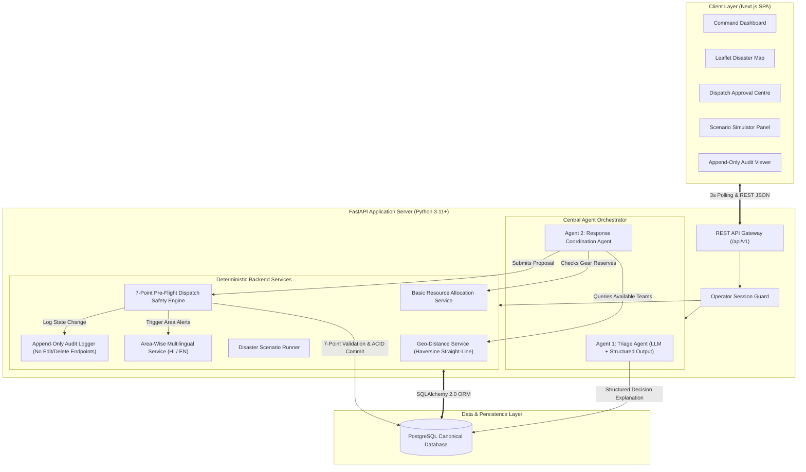
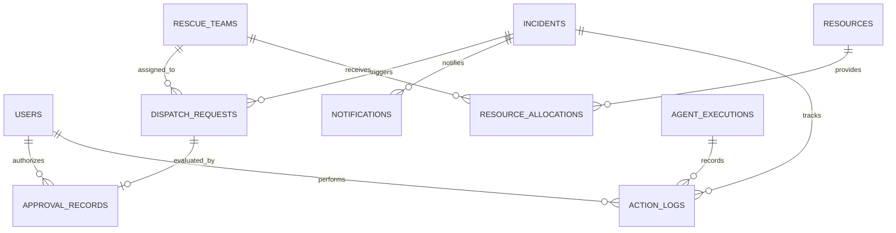

# RESQNET — Project Schema & Technical Architecture

**Document Version:** 1.1.0 (Audited & Revised)  
**Target Release:** AgentX Hackathon 2026 (PS-03: Multi-Agent Disaster Response Coordinator)  
**Engineering Design:** Solo Developer Architecture — Monolithic FastAPI + Next.js  
**Canonical Database:** PostgreSQL  

---

## 1. High-Level System Architecture

RESQNET is structured as a high-cohesion, low-coupling monolith designed specifically for solo-developer implementation speed and deterministic operational safety.



---

## 2. Canonical Database Choice & Justification

### Selected Engine: PostgreSQL 15+
- **Architectural Rationale:**
  1. **Strict ACID Concurrency:** The **7-Point Pre-Flight Dispatch Verification** requires database row-level locking (`SELECT FOR UPDATE`) to prevent conflicting team dispatches or duplicate approvals when an operator confirms deployment.
  2. **Native JSONB Storage:** The Triage Agent's **structured decision explanation** and tool telemetry require indexing and querying inside relational entities.
  3. **Zero Divergence:** Using one canonical engine eliminates ORM dialect differences and edge-case testing between development and evaluation.

---

## 3. Relational Database Schema



---

### Entity Definitions & Data Dictionaries

#### 1. `users` (Operators & Commanders)
Stores authenticated EOC operators.
| Column | Type | Constraints | Description |
| :--- | :--- | :--- | :--- |
| `id` | VARCHAR(36) | PRIMARY KEY | UUID identifier |
| `callsign` | VARCHAR(50) | NOT NULL, UNIQUE | Operational call-sign (e.g. `HQ-DELTA-1`) |
| `role` | VARCHAR(30) | NOT NULL | `INCIDENT_COMMANDER`, `DISPATCH_OFFICER` |
| `is_active` | BOOLEAN | DEFAULT TRUE | Operational status |
| `created_at` | TIMESTAMP WITH TIME ZONE | DEFAULT NOW() | Account creation |

#### 2. `incidents` (Flood Distress Reports)
Stores distress calls and the Triage Agent's structured output.
| Column | Type | Constraints | Description |
| :--- | :--- | :--- | :--- |
| `id` | VARCHAR(36) | PRIMARY KEY | Identifier (e.g. `INC-204`) |
| `raw_report` | TEXT | NOT NULL | Raw caller or SOS message |
| `location_text`| VARCHAR(255) | NOT NULL | Parsed street or landmark name |
| `latitude` | FLOAT | NOT NULL, INDEX | Decimal latitude (-90.0 to +90.0) |
| `longitude` | FLOAT | NOT NULL, INDEX | Decimal longitude (-180.0 to +180.0) |
| `severity` | VARCHAR(20) | NOT NULL, INDEX | `P0_CRITICAL`, `P1_HIGH`, `P2_MEDIUM`, `P3_LOW` |
| `victim_count` | INTEGER | DEFAULT 1 | Estimated trapped or injured individuals |
| `vulnerability_tags`| JSONB | NOT NULL | Array: `["ELDERLY", "INFANT", "MEDICAL", "MOBILITY"]` |
| `water_depth_ft`| FLOAT | NULL | Estimated water depth |
| `status` | VARCHAR(30) | NOT NULL, INDEX | `PENDING_TRIAGE`, `TRIAGED`, `DISPATCH_PROPOSED`, `IN_PROGRESS`, `RESOLVED`, `CANCELLED` |
| `structured_explanation`| JSONB | NULL | Triage Agent structured decision explanation |
| `created_at` | TIMESTAMP WITH TIME ZONE | DEFAULT NOW(), INDEX | Submission timestamp |
| `updated_at` | TIMESTAMP WITH TIME ZONE | DEFAULT NOW() | Last state transition |

#### 3. `rescue_teams` (Emergency Response Units)
Field assets available for simulated deployment.
| Column | Type | Constraints | Description |
| :--- | :--- | :--- | :--- |
| `id` | VARCHAR(36) | PRIMARY KEY | Identifier (e.g. `TEAM-NDRF-01`) |
| `callsign` | VARCHAR(50) | NOT NULL, UNIQUE | Operational unit name |
| `agency` | VARCHAR(50) | NOT NULL | `NDRF`, `SDRF`, `CIVIL_DEFENSE`, `FIRE_SERVICE` |
| `current_latitude` | FLOAT | NOT NULL | Live GPS latitude |
| `current_longitude`| FLOAT | NOT NULL | Live GPS longitude |
| `status` | VARCHAR(30) | NOT NULL, INDEX | `AVAILABLE`, `DEPLOYED`, `ON_SCENE`, `BLOCKED`, `OFF_DUTY` |
| `capabilities` | JSONB | NOT NULL | Array: `["INFLATABLE_BOAT", "DIVING", "PARAMEDIC"]` |
| `crew_count` | INTEGER | NOT NULL | Rescuers in unit |
| `contact_radio`| VARCHAR(30) | NOT NULL | Radio channel or contact number |
| `current_incident_id`| VARCHAR(36) | NULL, FK(`incidents.id`) | Active incident assignment |
| `updated_at` | TIMESTAMP WITH TIME ZONE | DEFAULT NOW() | Telemetry update time |

#### 4. `resources` (Depot Equipment & Supply Inventory)
Physical equipment stored at regional distribution hubs.
| Column | Type | Constraints | Description |
| :--- | :--- | :--- | :--- |
| `id` | VARCHAR(36) | PRIMARY KEY | UUID |
| `depot_name` | VARCHAR(100) | NOT NULL | Depot name (e.g. `Kashmere Gate Depot`) |
| `item_type` | VARCHAR(50) | NOT NULL, INDEX | `INFLATABLE_BOAT`, `LIFE_JACKET`, `MEDICAL_KIT` |
| `total_quantity` | INTEGER | NOT NULL | Total inventory |
| `available_quantity`| INTEGER | NOT NULL | Unallocated stock |
| `latitude` | FLOAT | NOT NULL | Depot latitude |
| `longitude` | FLOAT | NOT NULL | Depot longitude |

#### 5. `resource_allocations` (Committed Gear to Operations)
Tracks equipment assigned to specific dispatches.
| Column | Type | Constraints | Description |
| :--- | :--- | :--- | :--- |
| `id` | VARCHAR(36) | PRIMARY KEY | UUID |
| `dispatch_request_id` | VARCHAR(36) | NOT NULL, FK(`dispatch_requests.id`) | Bound proposal |
| `resource_id` | VARCHAR(36) | NOT NULL, FK(`resources.id`) | Allocated item |
| `quantity` | INTEGER | NOT NULL | Quantity committed |
| `allocated_at` | TIMESTAMP WITH TIME ZONE | DEFAULT NOW() | Timestamp |

#### 6. `dispatch_requests` (AI-Formulated Deployment Proposals)
Proposals prepared by Response Coordination Agent for human evaluation.
| Column | Type | Constraints | Description |
| :--- | :--- | :--- | :--- |
| `id` | VARCHAR(36) | PRIMARY KEY | Identifier (e.g. `DSP-108`) |
| `incident_id` | VARCHAR(36) | NOT NULL, FK(`incidents.id`) | Target incident |
| `recommended_team_id` | VARCHAR(36) | NOT NULL, FK(`rescue_teams.id`) | Recommended unit |
| `structured_explanation`| JSONB | NOT NULL | Coordination Agent reasoning and score |
| `estimated_eta_mins` | INTEGER | NOT NULL | Estimated arrival time |
| `straight_line_distance_km`| FLOAT | NOT NULL | Haversine distance in km |
| `requested_resources`| JSONB | NOT NULL | Required equipment items |
| `status` | VARCHAR(30) | NOT NULL, INDEX | `PENDING_APPROVAL`, `APPROVED`, `REJECTED`, `SUPERSEDED` |
| `created_at` | TIMESTAMP WITH TIME ZONE | DEFAULT NOW() | Creation timestamp |

#### 7. `approval_records` (Human-in-the-Loop Decisions)
Immutable record of human commander authorizations.
| Column | Type | Constraints | Description |
| :--- | :--- | :--- | :--- |
| `id` | VARCHAR(36) | PRIMARY KEY | UUID |
| `dispatch_request_id` | VARCHAR(36) | NOT NULL, UNIQUE, FK(`dispatch_requests.id`) | Authorized proposal |
| `decided_by_callsign`| VARCHAR(50) | NOT NULL | Operator call-sign |
| `decision` | VARCHAR(20) | NOT NULL | `APPROVED`, `REJECTED` |
| `preflight_check_passed`| BOOLEAN | NOT NULL | Verification flag |
| `notes` | TEXT | NULL | Commander notes |
| `decided_at` | TIMESTAMP WITH TIME ZONE | DEFAULT NOW() | Decision timestamp |

#### 8. `notifications` (Area-Wise Multilingual Status Updates)
Bilingual advisory messages generated for citizens and teams.
| Column | Type | Constraints | Description |
| :--- | :--- | :--- | :--- |
| `id` | VARCHAR(36) | PRIMARY KEY | UUID |
| `incident_id` | VARCHAR(36) | NOT NULL, FK(`incidents.id`) | Target incident |
| `area_name` | VARCHAR(100) | NOT NULL | Target sector/area |
| `language` | VARCHAR(10) | NOT NULL | `EN`, `HI` |
| `message_content` | TEXT | NOT NULL | Formatted advisory text |
| `status` | VARCHAR(30) | NOT NULL | `RECORDED_AND_BROADCAST`, `FAILED` |
| `created_at` | TIMESTAMP WITH TIME ZONE | DEFAULT NOW() | Creation time |

#### 9. `action_logs` (Append-Only Audit Trail)
Append-only log of every state change across the system.  
*Strict Rule: The application provides zero endpoints to modify (`PUT`/`PATCH`) or delete (`DELETE`) these records.*
| Column | Type | Constraints | Description |
| :--- | :--- | :--- | :--- |
| `id` | VARCHAR(36) | PRIMARY KEY | UUID |
| `action_type` | VARCHAR(50) | NOT NULL, INDEX | `INCIDENT_INGEST`, `TRIAGE_COMPLETED`, `DISPATCH_APPROVED`, etc. |
| `actor` | VARCHAR(50) | NOT NULL, INDEX | `OPERATOR:HQ-DELTA-1`, `AGENT:TRIAGE`, `AGENT:COORDINATION` |
| `timestamp` | TIMESTAMP WITH TIME ZONE | DEFAULT NOW(), INDEX | Event timestamp |
| `incident_id` | VARCHAR(36) | NULL, INDEX | Related incident ID |
| `previous_state` | JSONB | NULL | Snapshot of state prior to action |
| `new_state` | JSONB | NOT NULL | Snapshot of state after action |
| `action_result` | VARCHAR(20) | NOT NULL | `SUCCESS`, `FAILED`, `ABORTED` |

#### 10. `agent_executions` (AI Pipeline Telemetry)
Execution traces for debugging and agent evaluation.
| Column | Type | Constraints | Description |
| :--- | :--- | :--- | :--- |
| `id` | VARCHAR(36) | PRIMARY KEY | UUID |
| `agent_name` | VARCHAR(50) | NOT NULL, INDEX | `TRIAGE_AGENT`, `RESPONSE_COORDINATION_AGENT` |
| `incident_id` | VARCHAR(36) | NULL, FK(`incidents.id`) | Target incident |
| `input_prompt` | TEXT | NOT NULL | Prompt payload sent to LLM |
| `raw_output` | TEXT | NOT NULL | Raw model output |
| `execution_time_ms`| INTEGER | NOT NULL | Latency in ms |
| `is_success` | BOOLEAN | NOT NULL | Success flag |
| `created_at` | TIMESTAMP WITH TIME ZONE | DEFAULT NOW() | Execution timestamp |

---

## 4. REST API Interface Specification

Base URL: `/api/v1`

### 4.1 Incidents Endpoints
- `POST /api/v1/incidents/ingest`: Accepts raw SOS report, triggers Triage Agent, and returns structured decision explanation.
- `GET /api/v1/incidents`: Retrieves incident list (supports filtering by `severity` and `status`).
- `GET /api/v1/incidents/{id}`: Full detail with attached dispatch proposals and audit logs.

### 4.2 Rescue Teams Endpoints
- `GET /api/v1/teams`: Returns list of all rescue teams with coordinates, status, and capabilities.

### 4.3 Dispatch Approvals Endpoints (Human-in-the-Loop)
- `GET /api/v1/approvals/pending`: Retrieves all proposals in status `PENDING_APPROVAL`.
- `POST /api/v1/approvals/{id}/decide`:
  - **Payload:** `{"decision": "APPROVED", "operator_callsign": "HQ-DELTA-1", "notes": "Approved for sector 18"}`
  - **Behavior:** Executes the **7-Point Pre-Flight Verification**:
    1. Recheck team availability (`AVAILABLE`).
    2. Recheck team capacity.
    3. Recheck required resources.
    4. Check if incident already dispatched.
    5. Validate operator session.
    6. Commit transaction (`SELECT FOR UPDATE`).
    7. Append audit log entry.
  - **Errors:** Returns `409 Conflict` if any pre-flight condition fails.

### 4.4 Audit Trail Endpoints
- `GET /api/v1/audit`: Read-only query of the append-only action logs. (No edit or delete endpoints exist).

### 4.5 Simulation Endpoints
- `POST /api/v1/simulation/start`: Initiates the *Yamuna Flash Flood* scenario.
- `POST /api/v1/simulation/reset`: Resets database to clean initial seed state.

---

## 5. Agent Tool Contracts (Deterministic Python Functions)

```python
from pydantic import BaseModel
from typing import List, Optional

class StructuredTriageExplanation(BaseModel):
    assigned_severity: str          # P0_CRITICAL, P1_HIGH, P2_MEDIUM, P3_LOW
    extracted_facts: dict           # water_depth_ft, location, hazards
    affected_population: int        # number of victims
    vulnerability_indicators: list[str] # ["ELDERLY", "INFANT", "MEDICAL"]
    relevant_prioritisation_rules: list[str]
    confidence_score: float         # 0.0 to 1.0
    missing_or_uncertain_information: list[str]

class TeamProximityMatch(BaseModel):
    team_id: str
    callsign: str
    straight_line_distance_km: float # Haversine straight-line baseline
    estimated_eta_mins: int
    matching_capabilities: list[str]

def classify_incident_report(raw_text: str) -> StructuredTriageExplanation:
    """Invoked by Triage Agent to produce structured decision explanation."""
    ...

def get_available_teams(target_lat: float, target_lng: float, required_capabilities: list[str]) -> list[TeamProximityMatch]:
    """Queries available teams and calculates Haversine straight-line distances."""
    ...

def check_resource_reserves(required_items: dict[str, int]) -> bool:
    """Verifies depot inventory availability."""
    ...

def execute_preflight_and_approve(proposal_id: str, operator_callsign: str, notes: str) -> bool:
    """Enforces 7-Point Pre-Flight Check in ACID transaction."""
    ...

def generate_area_status_update(incident_id: str, team_id: str, eta_mins: int) -> dict:
    """Generates area-wise Hindi and English status updates."""
    ...

def append_audit_log(action_type: str, actor: str, incident_id: str, prev_state: dict, new_state: dict, result: str) -> str:
    """Appends immutable entry to the append-only audit trail."""
    ...
```

---

## 6. Monorepo Directory Structure

```text
AgentX/
├── docs/
│   ├── APP_FLOW.md
│   ├── PRD.md
│   ├── IMPLEMENTATION_PLAN.md
│   ├── PROJECT_SCHEMA.md
│   ├── TRD.md
│   └── UI_UX.md
├── backend/
│   ├── app/
│   │   ├── api/
│   │   │   ├── endpoints/
│   │   │   │   ├── incidents.py
│   │   │   │   ├── teams.py
│   │   │   │   ├── approvals.py
│   │   │   │   ├── resources.py
│   │   │   │   ├── simulation.py
│   │   │   │   └── audit.py
│   │   │   └── router.py
│   │   ├── agents/
│   │   │   ├── orchestrator.py
│   │   │   ├── triage_agent.py
│   │   │   ├── coordination_agent.py
│   │   │   ├── tools.py
│   │   │   └── prompts.py
│   │   ├── core/
│   │   │   ├── config.py
│   │   │   ├── database.py
│   │   │   └── security.py
│   │   ├── models/
│   │   │   └── entities.py
│   │   ├── schemas/
│   │   │   ├── incident.py
│   │   │   ├── team.py
│   │   │   ├── dispatch.py
│   │   │   └── audit.py
│   │   ├── services/
│   │   │   ├── geo_service.py
│   │   │   ├── resource_service.py
│   │   │   ├── preflight_service.py
│   │   │   ├── notification_service.py
│   │   │   └── audit_service.py
│   │   ├── simulation/
│   │   │   ├── scenarios.py
│   │   │   └── scenario_runner.py
│   │   └── main.py
│   ├── requirements.txt
│   └── .env.example
├── frontend/
│   ├── src/
│   │   ├── app/
│   │   │   ├── layout.tsx
│   │   │   ├── page.tsx
│   │   │   ├── dashboard/page.tsx
│   │   │   ├── incidents/page.tsx
│   │   │   ├── approvals/page.tsx
│   │   │   ├── teams/page.tsx
│   │   │   ├── resources/page.tsx
│   │   │   └── simulation/page.tsx
│   │   ├── components/
│   │   │   ├── layout/
│   │   │   │   ├── Sidebar.tsx
│   │   │   │   └── Header.tsx
│   │   │   ├── map/
│   │   │   │   └── DisasterMap.tsx
│   │   │   ├── dashboard/
│   │   │   │   ├── StatCards.tsx
│   │   │   │   ├── CriticalQueue.tsx
│   │   │   │   └── ActivityTicker.tsx
│   │   │   ├── approvals/
│   │   │   │   └── ApprovalCard.tsx
│   │   │   └── common/
│   │   │       ├── Badge.tsx
│   │   │       ├── Button.tsx
│   │   │       └── Modal.tsx
│   │   ├── lib/
│   │   │   └── api.ts
│   │   └── types/
│   │       └── index.ts
│   ├── package.json
│   ├── tailwind.config.js
│   └── tsconfig.json
└── README.md
```
