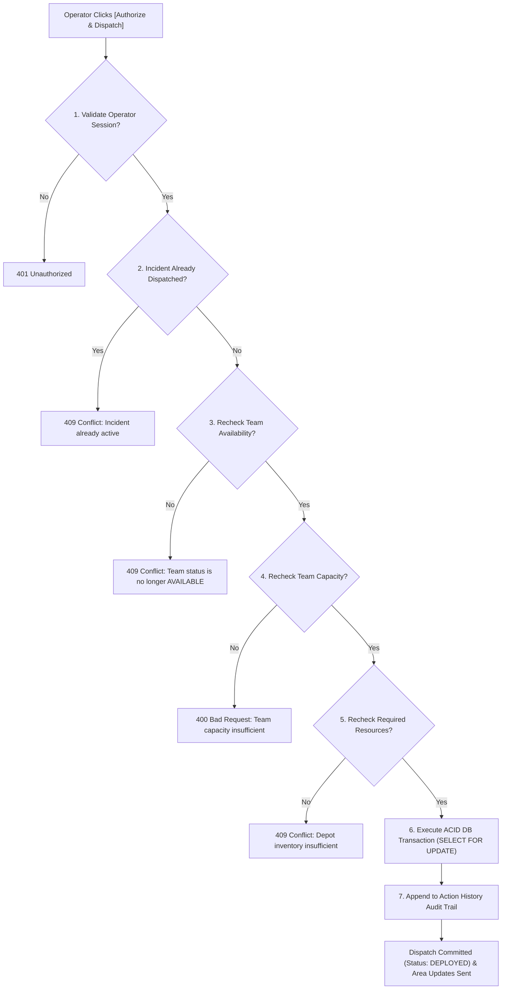

# RESQNET — Technical Requirements Document (TRD)

**Document Version:** 1.1.0 (Audited & Revised)  
**Target Release:** AgentX Hackathon 2026 (PS-03: Multi-Agent Disaster Response Coordinator)  
**Engineering Focus:** Reliability, Predictability & Deterministic Operational Safety  
**Development Lead:** Solo Developer & Google Antigravity  

---

## 1. Technology Stack & Framework Version Specifications

To balance bleeding-edge framework capabilities with rock-solid dependency compatibility during a 24-hour hackathon, all dependency versions are audited to ensure zero canary or experimental releases:

| Layer | Framework / Library | Version | Compatibility & Stability Justification |
| :--- | :--- | :--- | :--- |
| **Frontend Framework** | **Next.js (App Router)** | `15.x / 16.x (Latest Stable)` | Official stable release line. Fast server-side rendering, robust Turbopack builds, zero canary flags. |
| **UI Library** | **React / React DOM** | `19.0.x` (or `18.3.x` LTS) | Fully compatible with Next.js stable release and client hooks. |
| **Language (Web)** | **TypeScript** | `5.6+` | Strict mode enabled; enforces schema parity with backend Pydantic models. |
| **Styling** | **Tailwind CSS** | `3.4.x` | Production-tested utility CSS; perfectly typed with zero build overhead. |
| **Map Rendering** | **Leaflet / React Leaflet** | `1.9.4` / `4.2.x` | Lightweight canvas rendering, free OpenStreetMap tiles, zero external API key requirements. |
| **Iconography** | **Lucide React** | `0.450+` | Clean, standardized SVG icons for operational command dashboards. |
| **Backend Framework**| **FastAPI** | `0.115.x` | Ultra-high throughput async Python framework with native OpenAPI schema generation. |
| **Language (API)** | **Python** | `3.11+` | Core language for AI agent pipelines and geospatial arithmetic. |
| **Data Validation** | **Pydantic** | `v2.9+` | High-speed Rust-based parsing; enforces strict JSON schema contracts on LLM outputs. |
| **Database ORM** | **SQLAlchemy** | `2.0.x` | Modern declarative ORM; handles connection pooling and ACID transactional locks. |
| **Canonical Database**| **PostgreSQL** | `15+` | **Canonical MVP Database.** Selected for native row-level concurrency locking (`SELECT FOR UPDATE`), JSONB structured querying, and total relational integrity. |
| **LLM Provider API** | **Google Gemini / OpenAI / Anthropic** | API v1 | Replaceable provider abstraction via typed HTTP calls or LiteLLM. |

---

## 2. Agent Intelligence & Structured Decision Output

### 2.1 Elimination of Unconstrained Outputs
In safety-critical disaster command operations, unverified conversational outputs or vague text rationales are unacceptable. The system **never depends on an LLM's unverified output for safety-critical decisions**.

### 2.2 Structured Decision Explanation Schema
The Triage Agent is constrained to emit a **structured decision explanation** adhering to this strict Pydantic contract:

```python
from pydantic import BaseModel, Field
from typing import List, Dict, Any, Optional

class StructuredTriageExplanation(BaseModel):
    assigned_severity: str = Field(..., description="P0_CRITICAL, P1_HIGH, P2_MEDIUM, or P3_LOW")
    extracted_incident_facts: Dict[str, Any] = Field(..., description="Observable realities: water_depth_ft, rooftop, medical distress")
    affected_population: int = Field(..., ge=1, description="Estimated count of trapped or endangered individuals")
    vulnerability_indicators: List[str] = Field(..., description="Vulnerability tags: ELDERLY, INFANT, MEDICAL, MOBILITY")
    relevant_prioritisation_rules: List[str] = Field(..., description="Emergency doctrines triggered, e.g. RULE-FL-01")
    confidence_score: float = Field(..., ge=0.0, le=1.0, description="Numerical confidence in factual completeness")
    missing_or_uncertain_information: List[str] = Field(default_factory=list, description="Unconfirmed details needing field verification")
```

---

## 3. Dispatch Safety & Pre-Flight Verification Architecture

### 3.1 Non-Negotiable Operational Safety Rules
1. **Zero Autonomous Dispatch:** AI agents possess **no** backend tools or permissions to directly transition a team's status to `DEPLOYED` or deduct depot inventory. They can only emit a proposal in status `PENDING_APPROVAL`.
2. **Strictly Simulated Operations:** All dispatches and team movements in this prototype are **simulated**. Under no circumstances is this system connected to real-world emergency 911/112 dispatch infrastructure.
3. **Mandatory 7-Point Pre-Flight Verification:** Before any dispatch proposal is approved, the backend executes a deterministic safety check:



---

## 4. Append-Only Audit Trail Architecture

The system maintains an **append-only audit trail** in the `action_logs` table.
- **Immutability Definition:** Rather than claiming that a normal database table is physically immutable, the system enforces immutability by providing **zero application endpoints for modifying (`PUT`/`PATCH`) or deleting (`DELETE`) audit records**.
- **Required Data Contract:**
  1. `action_type`: Specific operational event (e.g. `INCIDENT_INGEST`, `TRIAGE_COMPLETED`, `DISPATCH_APPROVED`, `TEAM_BLOCKED`).
  2. `actor`: The entity initiating the action (e.g. `OPERATOR:HQ-DELTA-1`, `AGENT:TRIAGE`).
  3. `timestamp`: UTC ISO-8601 timestamp generated at database write.
  4. `incident_id`: UUID of the associated incident.
  5. `previous_state`: JSON snapshot of the entity prior to modification.
  6. `new_state`: JSON snapshot of the entity following modification.
  7. `action_result`: Outcome indicator (`SUCCESS`, `FAILED`, `ABORTED`).

---

## 5. Simplified Infrastructure & Polling Strategy

### 5.1 Canonical Database Engine: PostgreSQL
- **Decision:** PostgreSQL is the single canonical database for both local development and evaluation.
- **Justification:** Eliminates dual-database dialect discrepancies. Guarantees standard PostgreSQL row-level locks (`SELECT ... FOR UPDATE`) needed to prevent concurrent operator dispatch conflicts.

### 5.2 Straightforward Dashboard Polling
- **Implementation:** To avoid the socket dropouts, state desynchronization, and debugging friction of WebSockets during a 24-hour sprint, the dashboard uses **straightforward polling**:
  - `setInterval` every **3.0 seconds** on `/api/v1/incidents` and `/api/v1/approvals/pending`.
  - Advanced E-Tag and conditional header caching are kept optional and deferred.
  - Optimistic UI updates provide immediate visual feedback when an operator acts.

### 5.3 Geographic Distance Modeling Clarification
- **Straight-Line Geographic Distance (Haversine Formula):** Used as the **P0 baseline** for rapid proximity ranking and ETA calculation (assuming 15 km/h boat speed in floodwaters).
- **Road-Route Distance:** Street-network routing that takes into account flood-inundated roadways and bridge closures requires road-network routing engines and is designated as a **P1 feature**.

---

## 6. Failure Modes & Deterministic Fallbacks

| Failure Event | Detection | Immediate System Action | Recovery / Fallback Path |
| :--- | :--- | :--- | :--- |
| **LLM Provider API Outage (>8s)** | HTTP Timeout / 5xx | Logs error to `agent_executions`. Sets fallback flag. | Executes **Deterministic Rule-Based Triage Engine**: Regex scans for hazard terms ("roof", "trapped", "medical", "infant") to compute severity and populate a structured decision explanation. |
| **Malformed Output (JSON Error)** | Pydantic `ValidationError` | Retries once with validation error payload. | If 2nd attempt fails, sets incident severity to `P1_UNVERIFIED` and flags for manual human triage. |
| **Team Unavailability / Road Obstruction** | Field radio update or telemetric status change to `BLOCKED` | Central Orchestrator catches status transition event. | Cancels pending proposal, marks incident `RE_COORDINATION_NEEDED`, and triggers Response Coordination Agent to locate next closest unit. |
| **Concurrent Operator Dispatch Conflict** | Row lock / Conflict check in Pre-Flight Check | First transaction commits; second transaction encounters conflict. | Second operator receives clean `409 Conflict: Proposal already decided by Operator X`. UI updates immediately. |

---

## 7. Performance & Latency Budgets

| Operation | Latency Budget | Implementation Strategy |
| :--- | :--- | :--- |
| **Incident Ingestion to Database** | `< 150 ms` | Asynchronous FastAPI handler; database write precedes agent trigger. |
| **LLM Triage Classification** | `< 3.5 seconds` | Fast tier model (`gemini-1.5-flash` / `gpt-4o-mini`) with strict Pydantic token budget. |
| **Response Coordination Matching** | `< 1.0 second` | In-memory Haversine distance matrix with indexed PostgreSQL queries. |
| **7-Point Pre-Flight Verification & Commit** | `< 250 ms` | Single ACID transaction row lock. |
| **Map Re-render (50+ markers)** | `< 16 ms (60 FPS)` | Leaflet canvas layer with SVG pins. |

---

## 8. Testing Strategy

1. **Unit Tests (`pytest`):**
   - Haversine straight-line distance accuracy.
   - 7-Point Pre-Flight check validation (rejects already-dispatched or unavailable teams).
   - Structured explanation Pydantic validation.
2. **Agent Verification Harness (`test_agents.py`):**
   - Evaluates 5 standardized flood distress calls against expected severity classifications.
3. **End-to-End Smoke Test (`test_e2e_flow.py`):**
   - Ingest SOS -> Triage Agent -> Coordination Agent -> 7-Point Safety Check -> Commit -> Area Updates -> Append-Only Audit.
